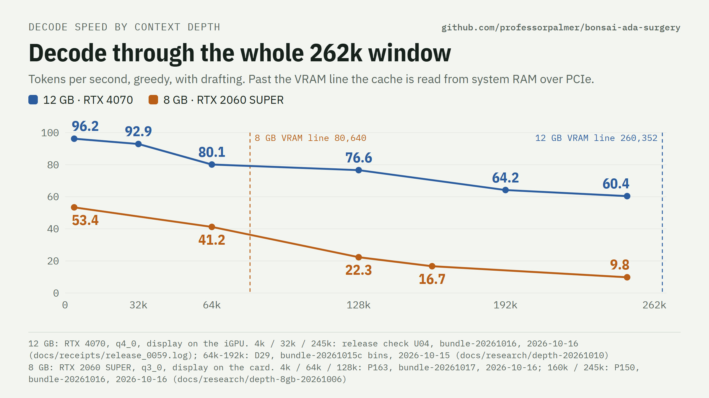
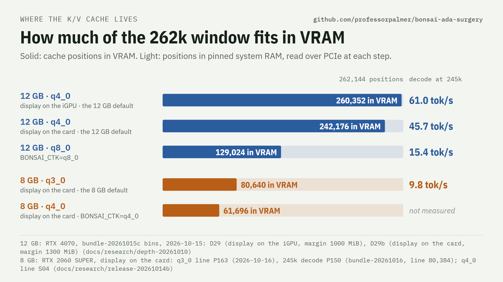
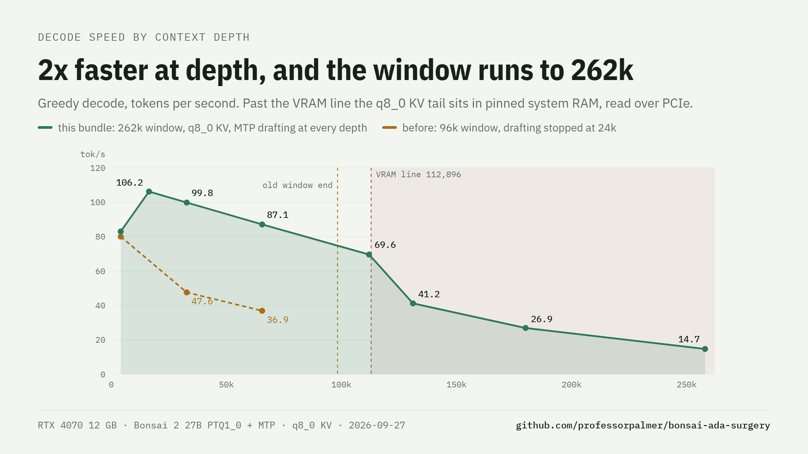

# Bonsai 2 27B on a 12 GB card

On a 12 GB card the launcher serves the full 262,144-token window with a q4_0 K/V cache. On an RTX 4070 with the
display on the CPU's iGPU, 260,352 of the 262,144 positions stay in VRAM. Decode at 245k is 60.4 tok/s.

## Setup

1. Follow [Quick start (Windows)](../build/README.md#quick-start-windows-nvidia): the release zip, the model file and
   the MTP head file in `models\`.
2. Run `.\start-server.ps1`. On a card with more than 8.5 GB and up to 14 GB of VRAM it prints
   `window 262144 / q4_0 (12 GB default, BONSAI_CTK=q8_0 for the previous one)`.
3. Optional: put the display on the CPU's integrated graphics ([below](#getting-more-positions-into-vram)). This
   gives the cache more VRAM.

Settings: [launcher settings](../build/KNOBS.md). Linux: [Quick start (Linux)](../build/README.md#quick-start-linux-nvidia).

## Numbers (q4_0, the default)

RTX 4070 12 GB, PCIe 4.0 x16, memory clock 11,751 MHz under load, display on the iGPU. `bench/quick_tps.py`: mean
of a code, a prose and a bash prompt, 400-token greedy answers, MTP and lookup drafting.

| depth | 4k | 32k | 64k | 128k | 192k | 245k |
| --- | ---: | ---: | ---: | ---: | ---: | ---: |
| decode (tok/s) | 96.2 | 92.9 | 80.1 | 76.6 | 64.2 | 60.4 |

4k, 32k and 245k: release check U04 of bundle-20261016, 2026-10-16 ([`docs/receipts/release_0059.log`](../receipts/release_0059.log),
[release-20261016](../research/release-20261016/EXPERIMENTS.md)). 64k-192k: D29, bundle-20261015c bins with q4_0,
2026-10-15 ([depth-20261010](../research/depth-20261010/EXPERIMENTS.md#d29-result-kv-type-on-the-12-gb-recipe-2026-10-15-1547-1742)).
With the display on the card the VRAM line is 242,176 positions, and decode at 192k / 245k is 62.5 / 45.7 tok/s (D29b).

| prompt read (prefill), code prompt | tok/s | time to first token |
| --- | ---: | ---: |
| 4k, cold (4,048 tokens) | 1,294 | 3.1 s |
| from 4k to 32k (28,512 new tokens) | 1,126 | 25.3 s |
| from 32k to 245k (212,368 new tokens) | 477 | 445 s |
| cold 64k, 128k, 245k with q4_0 | not measured | not measured |

Same source: U04, 2026-10-16. Without the drafter, q4_0 decodes as fast as q8_0 at 4k and faster deeper (32k +3.8 %,
128k +9.6 %, U04b).

Quality with q4_0: HumanEval 164 158/164 (the q8_0 runs: 158); at 245k exact code copies 20/20 and needles 24/24
(q8_0: 20/20, 23/24); perplexity +0.21 % (-c 2048). Details: [Quality](../quality/README.md).

## Why q4_0

q4_0 uses 18,432 B per position, q8_0 34,816 B. With q4_0 a 12 GB card holds ~99 % of the window in VRAM, so decode
does not fall off past ~129k: 245k is 4x the q8_0 speed. Per token, q8_0 is more precise (1 flipped top token in 160
positions against 1 in 48 for q4_0). On the task tests at 245k the two are equal. `BONSAI_CTK=q8_0` keeps the q8_0
recipe for short windows. Cards with more than 14 GB keep q8_0 by default.

Long conversations: [saved conversations](../agents-layer/SAVED_CONVERSATIONS.md) restore a long conversation after
a restart instead of a cold read. Agent use and the layer: [agents-layer](../agents-layer/README.md).

## Getting more positions into VRAM

With the q4_0 default, the display on the iGPU gives 260,352 positions in VRAM against 242,176 with the display on
the card, and decode at 245k 61.0 against 45.7 tok/s (D29, D29b). The measurement below is from the q8_0 recipe.

Every GB of VRAM the desktop does not use is ~30k more q8_0 positions at full speed. Run the display from the
CPU's integrated graphics (monitor on the motherboard output, iGPU enabled in the BIOS) and set GPU-accelerated
apps (browser, Discord, remote-desktop host) to the iGPU in Windows **Settings > System > Display > Graphics**.
Measured on this 4070: desktop VRAM 930 -> 285 MiB, the safe margin 1300 -> 1000 MiB, VRAM line 95k -> 113k
positions, decode at 112k from PCIe-bound to 70 tok/s. ([chart](img/igpu.png)) (Estimated beforehand: ~1 GB and ~30k positions. Windows
keeps ~220-275 MiB of compositor surfaces on the discrete card regardless, so the real gain was ~17k.)

## Other cards

| Card | Recipe | Notes |
| --- | --- | --- |
| 10-14 GB | defaults | this page (q4_0, 262k) |
| more than 14 GB | defaults | q8_0; the whole q8_0 window fits on 16 GB and up: the tier switches itself off |
| 8 GB (2060 Super, 3060 Ti, 4060) | defaults (the launcher detects the card), plus `build\make_mtp_q4head.ps1` | q3_0, 262k window with 24 GB of RAM or more: [8 GB](../8gb/README.md) |

Past the VRAM line decode is bound by PCIe (4.0 x16 here, ~23 GB/s). PCIe 3.0 or x8 slots halve those rows.

## The q8_0 recipe (`BONSAI_CTK=q8_0`, the 12 GB default before bundle-20261016)

With q8_0 the 12 GB card holds the first ~119k-129k positions; the rest of the cache (~5 GB) sits in pinned system
RAM, so decode slows past the VRAM line and the box needs ~8 GB of free RAM.

| RTX 4070 12 GB, served, one slot | decode, new text (tok/s) | decode, code (tok/s) | prefill (tok/s) |
| --- | ---: | ---: | ---: |
| 4k tokens of context | **102** | 102 | 1,173 |
| 16k | **83** | 242 | 1,137 |
| 32k | **78** | 175 | 1,031 |
| 64k | **69** | 109 | 867 |
| 112k (in VRAM) | **61** | 91 | 698 |
| 131k | **30** | 63 | 649 |
| 180k | **17.9** | 28 | 547 |
| 258k (the window's end) | **8.6** | 12.1 | 436 |

Measured 2026-10-08 with `bench/depth_table.sh` on the released bundle, a fresh prompt at each depth: 400-token
greedy answers (thinking off) with the default drafting (lookup + MTP head). New text = an essay; code = a
Python module, where the lookup drafter copies the answer's own repeated lines; prefill = cumulative for the
whole prompt. GDDR6X +1500 MHz (as in every number in this repo since #221), display on the CPU's iGPU. What those numbers replace:

| | before (this repo, Sep 2026) | now |
| --- | --- | --- |
| window on 12 GB with q8_0 KV | 96k (q4_0 for 262k) | **262,144** |
| decode at 32k / 64k | 47.6 / 36.9 | **78 / 69** on new text, **175 / 109** on code (2026-10-08 table) |
| decode when the answer copies the context (file rewrite), 4k / 130k / 250k | 117 / 63 / 18.5 (MTP only) | **352 / 164 / 66** (lookup drafting) |
| KV cache at 262k on 12 GB | q4_0, much of the window in system RAM | q4_0 with **~99 % of the window in VRAM** (245k 4x faster than q8_0) |
| apps that send `effort: "high"` | HTTP 500 on every request | answered (normalized to medium) |
| apps with a 256-4096 token cap, thinking on | cut off mid-think | answered (cap raised to the think budget) |
| HumanEval 164 from apps that send `effort: "high"` | 0 (HTTP 500) | **160** |
| tool calls parsed (9 requests) | 1 of 9 (JSON asked for in content) | **9 of 9** (native XML, server grammar) |
| AppWorld, all 168 test tasks, ReAct code agent | 64.3% on the stock fork (published, 2.13-bpw file); 16 wrong-format replies, 15 step-cap exits | **70.8%** (95% CI 63.6-77.2); **1 and 1** |
| long exact-work suite, 37 tasks, same seeds | 17 raw | **28** behind the layer (13 rescues, 2 losses); 29 on a second seed set |
| AIME 2025 (60) / MMLU-Pro (100), raw -> layer | 52 / 71 | **56** / **76** |

How the tiered cache and the drafting work, and every receipt: [`Q8_FULL_CONTEXT.md`](Q8_FULL_CONTEXT.md). Short version:

- **Tiered KV cache** (`--kv-vram-cells`): the first ~119k positions of each layer's K/V live in VRAM, the rest
  in pinned system RAM mapped into the same CUDA address range. Kernels are unchanged and output is
  **bit-identical** to an all-VRAM cache. Past the line, attention copies the used RAM rows into VRAM with the
  copy engine first.
- **MTP drafting at every depth** (`--spec-draft-window`): the draft head only needs recent context, so its cache
  keeps the last 16k rows and stays small. With quantized-KV decode on the tensor-core attention kernel (one K/V
  read per verify batch), drafting now pays at every depth; the old 24k cutoff is gone.
- **Harness-proofing** (`--reasoning-effort-allow`, `--reasoning-max-tokens-floor`): the same weights score 0 to
  160 of 164 on HumanEval depending on what the client sends. The server absorbs both causes.
- **Lookup drafting** (patch 0039, on by default): an n-gram drafter drafts text that is already in the context, up
  to 32 tokens at a time, in front of the MTP head. When the answer copies the context (file rewrites, edit calls,
  quoted logs), decode is 3 to 3.6 times faster (file rewrite 117 -> 352 tok/s at 4k, 18.5 -> 66 at 250k). New text
  is unchanged, and so is the output.
- **Prefill past the VRAM line** (patch 0041): the K/V rows that a prefill batch writes past the line go to VRAM
  first and then to system RAM in whole blocks, and the next layer's RAM rows are copied while the layers before it
  compute. A 258k prompt: 369 -> 436 tok/s (time to first token 697 -> 589 s), same output.
- **Many tools cost no decode speed** (patch 0042): with speculative decoding the server copies the sampler on
  each draft step, and with tools the sampler holds the tool-call grammar. The grammar copy searched every grammar
  element for each stack entry, about 15 ms per step with 107 tool schemas. Now a binary search: an agent request
  with 107 tools at 63k, 41.8 -> 61.2 tok/s (2 tools: 63.5), same output ([issue #7](https://github.com/professorpalmer/bonsai-ada-surgery/issues/7)).
- What we took from [syv-ai/HyperQwen](https://github.com/syv-ai/HyperQwen), what we measured and what we decided:
  [`docs/speed/HYPERQWEN.md`](../speed/HYPERQWEN.md).

More on speed past the VRAM line: [docs/speed/DEPTH.md](../speed/DEPTH.md). Decode efficiency below the line:
[docs/speed/decode-efficiency.md](../speed/decode-efficiency.md). Older receipts: [docs/receipts/README.md](../receipts/README.md).
