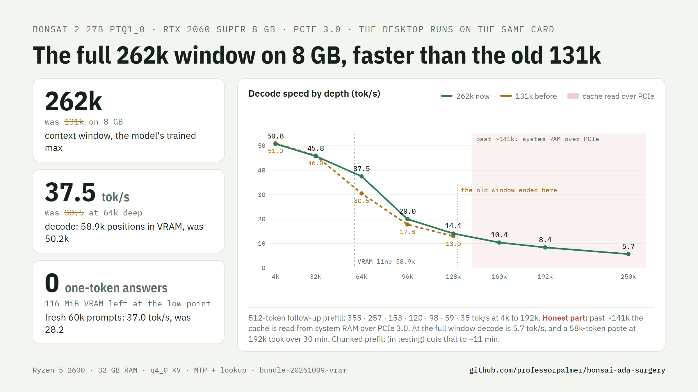

# Upgrading from an older bundle

To upgrade: `git pull` this repo, unzip the latest `bonsai-bundle-win-x64.zip` over it (new binaries in `bundle-20261008-tier`; it carries
the launcher, layer, suite and docs at the tag), run `layer\fetch_runtime.ps1` once (downloads the sandbox runtime,
installs the `wasmtime` Python package, runs the 14 isolation canaries), then `start-server.ps1` as before. The
launcher prints `layer on` when the runtime is present and falls back to the plain server when it is not;
`BONSAI_LAYER=0` turns it off. The suite runs against any OpenAI-compatible endpoint:
`python suite\run_suite.py --base http://127.0.0.1:18080 --base-b http://127.0.0.1:8080 --out suite-out`.

## What each bundle changed (newest first)

`bundle-20261019b` (engine `810d93e5aa`, patches 0070-0071): on **8 GB cards** the launcher now turns on replay rollback
and drafts 2 tokens below and past the VRAM line (was 1 / 1). Replay keeps one recurrent-state plane instead of one per
draft token, so a draft token costs ~7 MiB of VRAM instead of ~150 MiB: the VRAM line holds ~10k more positions, and the
deeper draft is affordable. RTX 2060 SUPER: decode at 128k 23.0 -> 31.8 tok/s (+38 %, the previous default against the new one); the 245k code-set check gives the same
answers as 1 / 1 (#138, P213-P217). `BONSAI_RS_REPLAY=0` keeps the previous 1 / 1 recipe; other cards are unchanged
(`BONSAI_RS_REPLAY=1` turns replay on there). Patch 0071: past the VRAM line the server no longer writes the CUDA graph
line at every step (issue #7). Gates: `docs/research/release-20261019b`.

`bundle-20261019a` (no engine change): through the layer, a reply that `max_tokens` cut inside the layer's own Python tool call came back empty; the layer now asks once more without its tool, so the reply has text (such a reply can use up to twice `max_tokens`). Gates: `docs/research/release-20261019a`; details: `docs/research/cut-retry-20261019`.

`bundle-20261018f` (no engine change): the layer saves after every answer of a long conversation (a delta), so the next
turn restores exactly the state after the last answer and reads only the new turn, also when several conversations take
turns. A save that would evict another conversation's save used in the last 10 minutes is skipped
(`BONSAI_SLOT_CACHE_PROTECT`). Three interleaved conversations with restarts, 6 GB budget: mean wait 9.4 -> 6.7 s, answers equal to
cache-off at 45 of 45 turns; under a 3 GB budget -35 % against the previous design. `BONSAI_SLOT_CACHE_EVERY=0` keeps the
previous behaviour. Gates: `docs/research/release-20261018f`.

`bundle-20261018e` (no engine change): after 8 deltas the full save of a conversation runs when the layer has been idle
for 30 s (`BONSAI_SLOT_CACHE_IDLE`), not right after an answer, so a slow drive never holds up the next turn; after 32
deltas (`BONSAI_SLOT_CACHE_CHAIN_MAX`) it is forced. Gates: `docs/research/release-20261018e`.

`bundle-20261018d` (no engine change): the save before the request (a conversation whose answer the next turn renders
differently, or `BONSAI_SLOT_CACHE_AFTER=0`) is now also a delta of the last save. There the answer waits for the save:
30 turns with restarts, mean wait 53.2 -> 14.2 s (-73 %), the same answers. Gates: `docs/research/release-20261018d`.

`bundle-20261018c` (engine `a6d4fc698f`, patches 0068-0069): with the layer and `BONSAI_SLOT_SAVE_PATH`, a save after the
answer writes only the tokens since the last save (a delta; a full save every 8, `BONSAI_SLOT_CACHE_CHAIN`). A slow drive
no longer holds up the next turn: on the dev drive the full save of a 173k conversation took 70.6 s, a delta 0.08 s;
30 turns with 20 s between them: mean wait -44 %, normal turns -56 %, answers equal to the cache-off session 30/30. Gates:
`docs/research/release-20261018c`.

`bundle-20261018b` (no engine change): with the layer and `BONSAI_SLOT_SAVE_PATH`, conversations now save **after the
answer** by default, so an answer no longer waits for a multi-GB save (4070, 30 turns with 20 s between them: mean wait
-44 %, answers equal to the cache-off session 30/30; RTX 2060 SUPER without pauses: session -2.3 %, answers 30/30).
`BONSAI_SLOT_CACHE_AFTER=0` turns it off. Gates: `docs/research/release-20261018b`.

`bundle-20261018` (engine `c5e73e7d81`, patch 0067): a speculative draft stops at the end of the answer, so the next turn
of a conversation reuses the whole state after the answer (9 of 9 turns, was 6 of 9; the same answers; decode speed
unchanged). On 8 GB cards, saved conversations save every 4,096 new tokens (RTX 2060 SUPER: restart turns -48.5 %, a
30-turn session -18.7 %). Opt-in `BONSAI_SLOT_CACHE_AFTER=1` saves after the answer (see the knob table). Gates:
`docs/research/release-20261018`.

`bundle-20261017b` adds a **spill guard** to the launcher (no engine change). When the card becomes full after the
server starts (a browser, a game or a second model takes VRAM, or the NVIDIA driver moves server memory to system
RAM), the server does not stop: it becomes much slower, or a later long prompt fails with "CUDA error: out of
memory". On an RTX 2060 SUPER a 200 MiB program after the start took prompt reads from ~400 to 70 tok/s. The launcher
now prints a `spill` line in its window when this happens (`BONSAI_SPILL_GUARD=0` turns it off; see the knob table).
It also has the layer's **read ahead**: a chat request with `"prefill_only": true` reads and saves a long prompt (a
big file or a repo) ahead of the question, so the question itself answers in seconds (2060: a 131k document, then
6.25 s for the question after a restart; needs `BONSAI_SLOT_SAVE_PATH`).

`bundle-20261017` makes **saved conversations work on every card, and automatic with the layer** (patches 0062-0066,
layer cache #157). With `BONSAI_SLOT_SAVE_PATH` set, a long conversation is saved to disk and comes back after a restart
in seconds instead of a cold read: on an RTX 2060 SUPER a **199k-token conversation answers ~6 s after a server restart**
(the cold read is 1,210 s); on an RTX 4070, 245k restores in ~2 s. With the layer on (the default), saving and restoring
happen by themselves for requests of 16k tokens and more. Fixed for 8 GB cards: the MTP draft context is now saved
with the conversation (`<file>.draft`), and the CUDA memory pool grows in small pieces with retries, so the first long
turn after a restore no longer runs slow or stops with a CUDA error (2060: 227 tok/s at 64k, 157 tok/s at 131k after a
restore; `BONSAI_SHARED_POOL=0` is no longer needed). The engine's answers are unchanged (byte-identical on an RTX
4070). A turn served from a saved state can differ from an uninterrupted session in a rare token, because the prompt
is cut into batches at other points (P160: one whitespace token in five turns).

`bundle-20261016b` makes **cold reads faster on Turing (sm_75) cards** (patches 0060 / 0061): prefill attention
packs 2 query heads per column group by default on sm_75 (no padding columns, fewer K/V tile loads). Measured on an
RTX 2060 SUPER, cold prompts: 64k 1.067x, 128k 1.110x, **245k 1,707 -> 1,489 s (1.147x)**; perplexity +0.02 %, KL 0, and at 245k
the copy and needle items equal the previous default. Other cards are unchanged (byte-identical answers on an RTX 4070).
`GGML_CUDA_FA_PREFILL_NCOLS2=8` turns it off. The launcher in this bundle also has `BONSAI_SLOT_SAVE_PATH`: on 8 GB cards
with MTP on, the first long turn after a restore is slow and can stop with a CUDA error; set `BONSAI_SHARED_POOL=0` (or
`BONSAI_SPEC=0`) when you use saved conversations (fixed in bundle-20261017).

`bundle-20261016` gives **12 GB cards the whole window at speed** and makes **sparse reads automatic on 8 GB** (patch
0059 and the launcher).
- **12 GB: the default K/V cache is now q4_0** (10-12 GB cards). It holds 260,352 of the 262,144 positions in VRAM with
  the display on another GPU (242,176 with the display on the card), so decode no longer falls off past ~129k: RTX
  4070, 245k **14.8 -> 60.4 tok/s** (4.1x), 192k 26.7 -> 64.2; with the display on the card, 245k 45.7 (3x). Quality at
  245k: exact copies 20/20 and needles 24/24 (q8_0: 20/20, 23/24); HumanEval 164 158/164 (the q8_0 runs: 158);
  perplexity +0.21 % (-c 2048). Without the drafter q4_0 is as fast as q8_0 at 4k and faster deeper (32k +3.8 %, 128k
  +9.6 %). `BONSAI_CTK=q8_0` restores the previous cache; cards with more VRAM keep q8_0.
- **8 GB: sparse host-tail reads are on by default, and cost nothing below the VRAM line.** The VRAM line stays the
  dense one; when a session goes past it, the engine times dense and sparse reads once per 16k of context and keeps
  the faster, and stores the choice (`%LOCALAPPDATA%\bonsai\sparse-calib.txt`) so the next run is the same. RTX 2060
  SUPER, q3_0, against sparse off on the same build: 64k-128k within 1.5 %, 160k +2.6 %, 245k +10 %; the same 128k
  answer byte for byte on two fresh servers; at 245k the exact copies and needles equal sparse off item by item. The sparse budget for q3_0 is 1/4 of the system-RAM part (a 1/8 budget
  lost a fact at 245k on a wider item set). `BONSAI_SPARSE=0` turns it off, `=1` forces it.
- Against bundle-20261014 (the q4_0 default before the q3_0 change), the 8 GB card is about 1.5x faster at depth:
  128k ~15.8 -> 22.8, 245k ~6.2 -> 9.8 tok/s.
- The launcher now survives starts with redirected output (hidden window, scheduled task: #16) and exits with the
  server's exit code.

`bundle-20261015c` fixes **agent tools that return images through the Responses API** (patch 0058, a cherry-pick of
ggml-org/llama.cpp `4098fdc922`). A harness on `/v1/responses` whose tool returned a screenshot got HTTP 400 ("Output
of tool call should be 'Input text'"), and every later request in that session failed too (#112). Now an
`input_image` in a tool output reaches the model like an image in a user message (with `BONSAI_MMPROJ` set).
Server-only change; the attention and cache code are the same as `bundle-20261015b`.

`bundle-20261015b` fixes the launcher of `bundle-20261015`: its q3_0 check never matched (two control characters in
the pattern), so 8 GB cards stayed on q4_0. The engine is the same; with 15b the 8 GB default is q3_0 as described
below. If you run `bundle-20261015`, take the new zip or set `BONSAI_CTK=q3_0`.

`bundle-20261015` makes **8 GB cards faster and puts more of the window in VRAM** (patches 0056 and 0057).
- **q3_0 K/V is the new 8 GB default** (patch 0056: 3.5 bits per value, 14,336 B per position instead of 18,432 for
  q4_0). The VRAM line holds 1.31x the positions (RTX 2060 SUPER, 262k: 61,696 -> 80,640). Decode against q4_0 on the
  same build: 4k -1.8 %, 64k +3.5 %, 128k **+44 %**, 192k **+34 %**. Perplexity at 16k +0.56 % against q4_0;
  HumanEval 164 163/164 (q4_0 158/164); exact copies and needles at 160k equal to q4_0. The rule for the default was
  written before the runs (`docs/research/q3port-20261013/`). `BONSAI_CTK=q4_0` keeps the previous default; an
  engine without q3_0 keeps q4_0 by itself.
- **Faster K/V tile loads in the tensor-core attention kernel** (patch 0057, bit-identical output): RTX 2060 SUPER,
  q4_0 at 64k 35.7 -> 39.6 tok/s (+11 %), 128k 15.7 -> 16.9 (+7.6 %), the same answers. RTX 4070 (12 GB, q8_0):
  within 1 %, HumanEval answers identical on 164 of 164.
- **`BONSAI_SPARSE=1` now keeps 1/8 of the host tail** (was 1/16). On wider item sets at 245k, 1/16 lost a fact past
  the VRAM line on both test cards; 1/8 kept every item. RTX 2060 SUPER: 160k 1.59x, 245k 1.76x dense (1/16:
  1.65x / 2.2x). Still opt-in.

`bundle-20261014` adds **sparse host-tail reads for deep sessions on 8 GB cards** (patch 0055, opt-in:
`BONSAI_SPARSE=1`). Past the VRAM line, a decode attention op reads only the system-RAM pages whose int8 page bounds
score highest (a budget that grows with the host tail, at least 12,288 cells) plus the last 1,024 cells, not the whole
host tail. Exact copies and needles are equal to dense at 160k, 200k and 245k on both test cards. RTX 2060 SUPER,
8 GB recipe, 262k window: 160k 10.6 -> 17.5 tok/s (1.65x), 245k 6.3 -> 13.7 (2.17x). The page bounds take VRAM
(about 170 MiB at 262k), so the VRAM line moves down and decode below about 100k is about 8 % slower on PCIe 3.0
(2.6 % on PCIe 4.0): that is why it is opt-in, and the launcher prints the trade. Off (the default), nothing changes.
Also in this bundle: with a separate draft model (`-md`) the launcher turns the shared CUDA pool off (it aborted at
start), and a [Vision (images)](VISION.md) section.

`bundle-20261013` makes **prefill faster on RTX 30 and 40 cards** (patch 0054, a port of ggml-org/llama.cpp#29353).
The 48 gated-delta-net layers now process a prompt in chunks with tensor-core (BF16 MMA) math instead of one token
after another. RTX 4070, 12 GB recipe, prefill: 4k 1197 -> 1280, 32k 1020 -> 1082, 128k 583 -> 602 tok/s (+3 to
+7 %); decode unchanged (within 1.6 %). Perplexity +0.02 %; HumanEval 164 158/164 (160 before: two long-thinking
answers changed with the float order). RTX 20 cards have no BF16 MMA: they keep the old kernel and log one
"skipped" line (RTX 2060 SUPER: the same speed, within 0.7 %).

`bundle-20261011` makes **decode past the VRAM line faster** (patch 0053). The tier prefetch (the copy engine moves
the next attention op's cache rows from system RAM while the current op computes) only ran without a CUDA graph,
and the launcher keeps CUDA graphs on. Now graphs whose attention reads system RAM run without one; graphs below
the line keep theirs. RTX 4070, 12 GB recipe: 192k 23.6 -> 29.4, 250k 12.7 -> 14.6 tok/s (4k-128k unchanged).
RTX 2060 SUPER, 8 GB recipe: 128k 12.8 -> 14.8, 192k 7.9 -> 8.6, 245k 6.2 -> 6.7 (4k / 32k unchanged). HumanEval
164 outputs identical. `GGML_CUDA_KV_TIER_GRAPHS=1` keeps the old behaviour ([docs/DEPTH.md](../speed/DEPTH.md)).

`bundle-20261010` sizes **system RAM use from the machine** (issue #16, from howdya: "bad allocation" and a server exit
on 16 GB of RAM) and makes **8 GB prefill at depth faster**. The prompt cache (default limit 8 GiB) and the context
checkpoints now follow the RAM (`ram` line): 48 GB or more, the server defaults; 24-47 GB, a 4 GiB cache and 32
checkpoints (12 GB recipe, 7 thinking requests with 26k-token prompts: 21.7 -> 17.5 GB peak); under 24 GB, sized from
the free memory at start (RTX 2060 SUPER as a 16 GB machine: 7/7, peak 10.5 GB). Patches 0051-0052 run prefill
attention past the f16 limit in 32k-cell chunks on the 8 GB preset (RTX 2060 SUPER at 250k: 25 -> 90 tok/s; decode
unchanged); the 12 GB recipe keeps it off for now (`GGML_CUDA_FA_CHUNK=32768` turns it on: +12-14 % prefill at
128k-249k on the RTX 4070). Patch 0050: a faster conv-state concat in draft verification steps, decode +1.4 %, same
text, HumanEval 160/164 before and after. `BONSAI_RAM_BUDGET=0` keeps the server's memory defaults.
`bundle-20261009-probe` fixes a **launcher stop on Windows PowerShell 5.1** (issue #14, from picmax): with Python on
PATH but without the `wasmtime` package, the probe for the optional layer stopped the launcher before the server
started. The probe now runs only when the layer's runtime is present and cannot stop the launcher. Engine and
measurements unchanged from `bundle-20261009-vram`.
`bundle-20261009-vram` puts **more of a long context in VRAM** (patches 0047-0049, from the 8 GB work). The packed
1-bit attention mask (0048-0049) is 1/16 of the f16 mask, 16 MiB instead of 256 MiB at 262k. On the 12 GB recipe the
saved 240 MiB move the VRAM line from 120,064 to 128,000 positions: decode 40.9 -> 48.2 tok/s at 131k and
21.2 -> 23.0 at 180k on the RTX 4070, prefill the same, text identical with drafting at 32k and 64k. On 8 GB cards
the preset now uses the full **262,144-token window** (with 24 GB of system RAM or more): partial staging (0047)
stops the staging buffer from growing with the window, and decode is faster than the old 131k preset at every depth
(RTX 2060 SUPER: 30.5 -> 37.8 tok/s at 64k). `LLAMA_ARG_KQ_MASK_PACKED=0` turns the packed mask off.

`bundle-20261009-agent` turns on **checkpoints inside long messages** for the 12 GB recipe too (patch 0046; the 8 GB
preset had it already). When an agent edits a tool result or sends a file again, the server restores the nearest
checkpoint instead of reading the whole prompt again: RTX 4070, 64.5 -> 15.5 s per request at 64k and 230 -> 49 s at
160k, text identical. It costs no VRAM and does not raise the server's limit of 32 checkpoints per slot (which a long
session already fills); long prompts that need no restore take about 1 s longer. `BONSAI_CKPT_EVERY=0` turns it off.
`bundle-20261009-pool` turns on the **shared CUDA pool** for the 12 GB recipe (one memory pool for the main and the
MTP draft context, and a 256-token draft micro-batch). It saves 74 MiB of VRAM, so the VRAM line moves up about 1.3k
positions: decode 39.3 -> 41.0 tok/s at 131k and 20.7 -> 21.2 at 180k on the RTX 4070, the same below the line; fresh
20k-60k prompts gave normal answers. It is on only with an engine that has patch 0045 (the stream order that makes
the pool safe with drafting); `BONSAI_SHARED_POOL=0` turns it off. Engine unchanged from `bundle-20261009-ckpt`.
`bundle-20261009-ckpt` adds patch 0046: **context checkpoints inside long messages**. This model keeps its
recurrent state only at user-message starts and at the prompt end, so a prompt that changes inside one long message
(an edited tool result, a file sent again) was processed again from the start. With `--checkpoint-every-nt` the
server also keeps a checkpoint every N tokens. The 8 GB preset sets 8192 (RTX 2060 SUPER at 64k: 227 -> 60.5 s per
request; `BONSAI_CKPT_EVERY=0` turns it off). On the 12 GB recipe it is on since `bundle-20261009-agent`;
measured there: 64.5 -> 15.5 s at 64k, 230 -> 49 s at 160k, text
identical. The launcher also shows the free VRAM at start and gives a warning when other programs hold much of it
(a start with 2.3 GB held put the VRAM line at 105k instead of 243k).
`bundle-20261008-8gbfix` fixes **1-token answers on 8 GB cards**. Since `bundle-20261007-8gb` the 8 GB preset turned
on a shared CUDA memory pool for the main and the MTP draft context. The two contexts run on two CUDA streams, and a
block freed by one could be reused by the other too early: on an RTX 2060 SUPER, a fresh prompt longer than about
30k sometimes got a 1-token answer (60k: 3 of 3 before, 0 of 3 now). The preset no longer turns the pool on; patch
0044 makes `GGML_CUDA_SHARED_POOL=0` turn it off, and patch 0045 orders the two streams so the pool is safe when it
is on (0 of 18 against 18 of 18). Patch 0043: the f16 prefill switch converts the cache only for batches of at least
64 queries, so lookup verify batches keep the in-place read (RTX 4070, switch on: 195.4 -> 212.4 tok/s on
copy-heavy decode; RTX 2060 SUPER: no change). The 8 GB preset now also turns on lookup drafting (RTX 2060 SUPER: file rewrites 58.2 -> 125.9 tok/s; `BONSAI_LOOKUP=0` turns it off). 12 GB cards with the default recipe: nothing changes. Unzip the new
bundle after `git pull`: an older zip has the old launcher.
`bundle-20261008-tools` makes **agent requests with many tools** faster (patch 0042). With speculative decoding the
server copies the sampler on each draft step, so that it can go back when a draft is rejected. With tools, the
sampler holds the tool-call grammar, and the grammar copy found each stack entry with a search over every element of
every grammar rule: about 15 ms per draft step with 107 tool schemas (an agent client with many MCP servers). Now
a binary search over the rule start addresses. 107 tools at 63k: 41.8 -> 61.2 tok/s on a plan-like answer,
47.6 -> 69.9 greedy, a request with three tool calls 60.1 -> 87.7; 2 tools give 63.5. Same output: same token counts,
same acceptance, same tool-call hash (`docs/receipts/issue7_fix_ab.log`). Requests without tools do not change.
`bundle-20261008-tier` makes **prefill past the VRAM line** faster (patch 0041). Each prefill micro-batch wrote its new
K/V rows to system RAM in small pieces over PCIe once the prompt passed the line (~0.68 ms per prompt token). Now
the rows go to VRAM first and then to system RAM as whole 16-byte stores, and the next layer's system-RAM rows
are copied while the layers before it compute. One 258k prompt: 369 -> 436 tok/s; 180k: 484 -> 547; below the line, decode and output
unchanged. The speed table above is measured again with this bundle (the September numbers were older engines).
`bundle-20261008-lookup` turns on **lookup drafting** (patch 0039): a lookup drafter drafts text that is already in the
context, up to 32 tokens at a time, and the MTP head drafts new text. When the answer copies the context (file
rewrites, edit calls, quoted logs), decode is much faster; on new text it is unchanged, and the output is the same:
file rewrites 117 -> 352 tok/s at 4k and 63 -> 164 at 130k, edit calls +19% / +25%, plain text 90 -> 90.5
(`docs/receipts/lookup_ab.jsonl`). The layer also sends an SSE keep-alive comment every 15 s while the server is silent,
so a long prefill does not drop through a proxy or a tunnel. `bundle-20261007-8gb` added patches 0036-0038 for 8 GB cards (the Turing one-column decode, the shared CUDA pool,
f16 prefill from pool memory; all off on 12 GB cards unless set) and the 8 GB launcher preset (`docs/8GB.md`).
Greedy output on the 12 GB recipe is identical to the previous bundle. `bundle-20261007-budget` added patch 0035: the server reports a forced close of the thinking (see *Reasoning budget
report* below), and a request that sends its own larger thinking budget gets an output cap to match. Greedy output
is identical to the previous binaries. `bundle-20261007-fixes` rebuilt the engine binaries for the first time since
`bundle-20260927`: the same 33 patches plus patch 0034, which stops JSON schemas with an empty `anyOf` / `oneOf` /
`type` from failing the request (issue #3; agent frameworks such as Hermes send them). The same bundle carries two
layer fixes from issues #3 and #4 and the Linux build fix from #5 (details in the release notes).
What the bundles between those two added runs beside the engine:

- `bundle-20261003`: **the Bonsai layer**, a small Python proxy the launcher starts in front of llama-server on the
  same port. It gives the model exact API cards for the Python modules a coding request involves, checks its code
  for names that do not exist, and offers a sandboxed Python tool (CPython 3.12 on WASI, no host files, network or
  processes) with the user's text available as `input.txt`. Clients need no changes. Measured, paired, same seeds:
  the long-exact-work suite 17 -> 28 of 37 (13 rescues, 2 losses) and 17 -> 29 on a second seed set, AIME 2025
  52 -> 56 of 60, MMLU-Pro 71 -> 76 of 100, HumanEval and MATH-500 unchanged; details and raw results in
  [`docs/research/quality-20260929/REPORT.md`](../research/quality-20260929/REPORT.md).
- `bundle-20261004`: the layer's tool loop at 12 rounds (the one loss mechanism, measured 7 of 9 vs 4 of 9 on the
  cases that hit the old cap), and the full AppWorld run of this serve: 70.8% task goal completion on all 168
  `test_normal` tasks (95% CI 63.6-77.2) against the published 64.3% for the 2.13-bpw file on the stock fork, with
  the two serving-side failure classes of that analysis (wrong-format replies, step-cap exits) down to 1 each.
